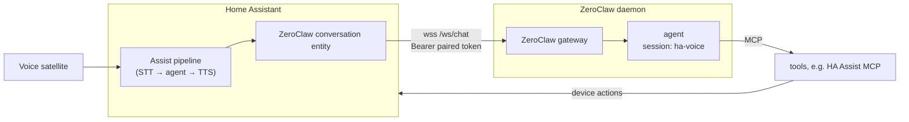

# ZeroClaw Conversation for Home Assistant

A Home Assistant conversation agent backed by a [ZeroClaw](https://github.com/zeroclaw-labs/zeroclaw)
agent. Point a voice pipeline at it and every Assist turn goes to that agent over the
ZeroClaw gateway's WebSocket, and the reply streams back into TTS.

Unlike a per-utterance assistant, the agent is persistent: by default every turn,
from every satellite, lands in **one long-running ZeroClaw session**. It
remembers the conversation across wake words and days, keeps its own long-term
memory, persona and tools, and it is the same agent you talk to on other channels
(e.g. Matrix).

There is no add-on. The agent loop, tools and model run inside ZeroClaw; this
integration only relays text.



## What each turn sends

```
[Home Assistant voice, Kitchen]
[context: <extra_system_prompt, if an automation passed one>]
turn off the lights
[Your reply is spoken aloud: one or two short sentences, plain words, no markdown, lists or URLs. Don't narrate what you checked.]
```

The first line tells the agent the reply will be spoken and which room the
satellite is in (from the device's area; can be turned off per agent). The last
line repeats the spoken-reply rule on every turn, after the user's words: smaller
models ignore it in a long system prompt, and even when it comes before the
question.

## Setup

1. ZeroClaw side:
   - `[gateway] require_pairing = true`.
   - Add a token for Home Assistant to `paired_tokens`. A SHA-256 hex hash of the
     token is accepted, so the plaintext never has to sit in the config.
   - Expose `/ws/chat` over TLS. A reverse proxy only needs to forward that path;
     it carries the WebSocket upgrade.
2. Install this repo through HACS as a custom repository (category *Integration*),
   or copy `custom_components/zeroclaw_conversation` into HA's `config/custom_components/`.
   Then restart HA.
3. **Settings → Devices & services → Add integration → ZeroClaw Conversation**. Enter
   the gateway URL (e.g. `wss://zeroclaw.example/ws/chat`), the token, the agent
   alias (an `[agents.<alias>]` in ZeroClaw's config) and a display name.
4. That creates the first conversation agent. Add more agents, or change one,
   from the integration's subentries.
5. **Settings → Voice assistants**: set the pipeline's conversation agent to it.

### Agent options

| Option | Default | Meaning |
|---|---|---|
| ZeroClaw agent alias | (required) | `[agents.<alias>]` to talk to |
| Session | persistent | `persistent`: one session for every turn. `per_conversation`: `ha-<conversation_id>`, fresh after Assist's idle timeout |
| Persistent session name | `ha-voice` | ZeroClaw session id in persistent mode |
| Include location | on | Prefix the turn with the satellite's area |

## Behaviour notes

- The agent's own tool calls enter HA's chat log as *external* tool calls with
  their results (output truncated to 2000 characters). HA displays them and
  never executes them. Text before a tool call is its own assistant message, so
  the Assist pipeline starts speaking it before the tools finish.
- Token-by-token streaming needs a ZeroClaw provider that streams. With
  `wire_api = "chat_completions"`, the `openai` family does not stream, so each
  step arrives as one block. An OpenAI-compatible `custom` provider with
  `native_tools = true` does stream.
- Tool approvals are not handled here. If the gateway asks this client for an
  approval, the client denies it rather than hanging the voice turn. Configure
  auto-approval, or out-of-band approval, on the ZeroClaw/MCP side.
- A turn may take up to 360 s before it times out. This leaves room for tools
  that wait on an out-of-band approval.
- In persistent mode every satellite shares one session. A new turn that arrives
  while the previous one is still running cancels the previous turn: ZeroClaw
  allows one in-flight turn per session, and the newer request wins.

## Development

```bash
python -m venv .venv && .venv/Scripts/python -m pip install -r requirements-test.txt pytest-aiohttp
.venv/Scripts/python -m pytest
```

`tests/test_client.py` runs the WebSocket client against a fake gateway that
speaks ZeroClaw's `zeroclaw.v1` frames (`connect`, `message`, `chunk`, `tool_call`,
`tool_result`, `approval_request`, `done`, `error`). The HA entity and config flow
are thin, and they are tested by installing into a real HA.
